# loteria_push

A new Flutter project.

# Lotería Push

## Descripción del proyecto

Lotería Push es una aplicación desarrollada con
Flutter, Firebase Cloud Messaging y Node.js.

Su propósito es implementar un juego de lotería
mexicana en el que un servidor controla las cartas
y envía notificaciones push a los jugadores.

El proyecto se desarrolla mediante la metodología
TDD (Desarrollo Guiado por Pruebas), utilizando
las etapas ROJO, VERDE y REFACTOR.

## Ronda 2. El servidor: la baraja y las reglas

### Objetivo

Implementar la baraja de lotería mexicana
y las reglas para identificar los patrones
ganadores de una partida.

Se utilizó la metodología TDD para verificar
el funcionamiento de cada componente.

## Prueba 1. La baraja de lotería

### Objetivo

Comprobar que la baraja contiene 54 cartas
con identificadores únicos y que se pueden
generar tablas de 16 cartas diferentes.

### Archivos desarrollados

- `server/test/baraja.test.js`
- `server/baraja.js`

### Fase ROJA

Primero se creó el archivo baraja.test.js
con seis pruebas automatizadas.

Al ejecutar las pruebas, estas fallaron porque
todavía no existía el archivo baraja.js.

**Comando utilizado:**

`node --test test/baraja.test.js`

**Evidencia de la fase ROJA:**

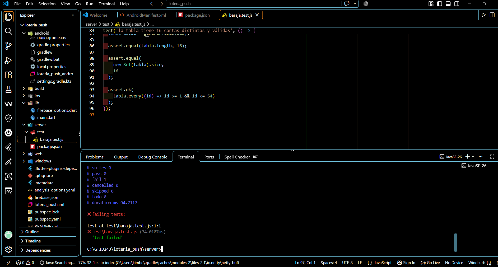

### Fase VERDE

Posteriormente se implementó baraja.js,
que contiene las 54 cartas y las funciones
necesarias para mezclarlas y generar tablas.

Se utilizó el algoritmo Fisher-Yates para
mezclar las cartas sin repetirlas.

También se implementó un generador con semilla
para obtener resultados reproducibles durante
las pruebas.

**Evidencia de la fase VERDE:**

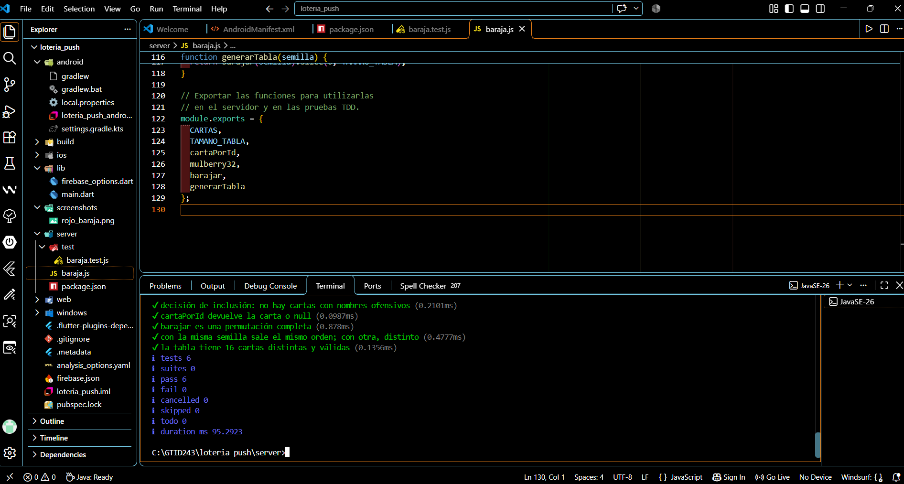

### Pruebas realizadas

1. Verificar que existen 54 cartas únicas.
2. Comprobar los nombres de las cartas.
3. Buscar cartas mediante su identificador.
4. Verificar que la baraja contiene todas las cartas.
5. Comprobar el orden obtenido con una semilla.
6. Generar una tabla de 16 cartas diferentes.

### Resultado

Se implementaron las funciones de la baraja
y se comprobó su comportamiento mediante
seis pruebas automatizadas.

## Prueba 2. Líneas ganadoras

### Objetivo

Identificar los patrones ganadores dentro
de una tabla de lotería de 4 filas por 4 columnas.

### Archivos desarrollados

- `server/test/lineas.test.js`
- `server/lineas.js`

### Fase ROJA

Primero se creó el archivo lineas.test.js,
con 16 pruebas automatizadas.

Las pruebas verifican las filas, columnas,
diagonales, esquinas, centro y tabla llena.

Al ejecutar las pruebas, estas fallaron
porque todavía no existía lineas.js.

**Comando utilizado:**

`node --test test/lineas.test.js`

**Evidencia de la fase ROJA:**

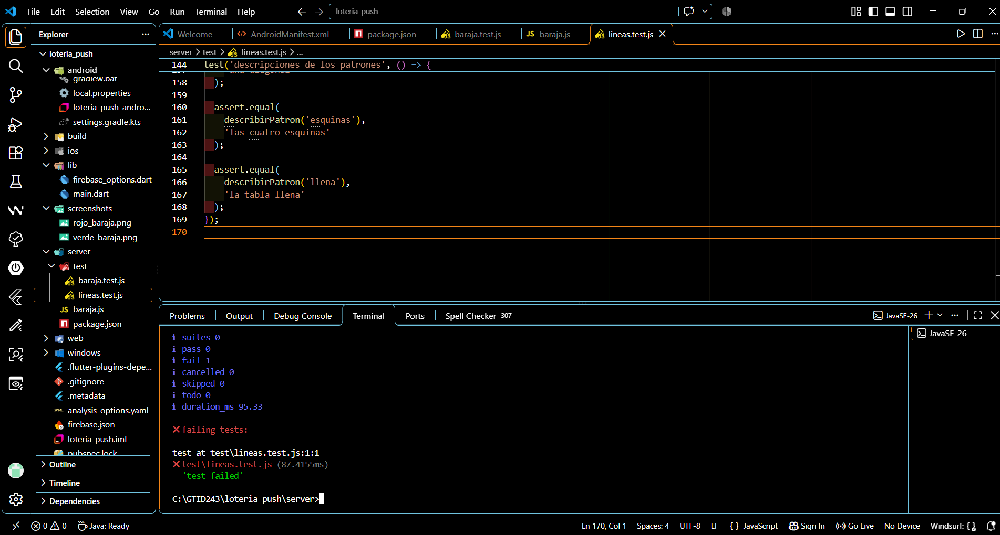

### Fase VERDE

Posteriormente se implementó lineas.js,
que permite identificar los patrones ganadores
a partir de las cartas cantadas.

También se desarrolló una función para detectar
cuando al jugador le falta una sola carta
para ganar la partida.

Esta función permitirá implementar más adelante
la notificación push "¡Casi!".

**Evidencia de la fase VERDE:**

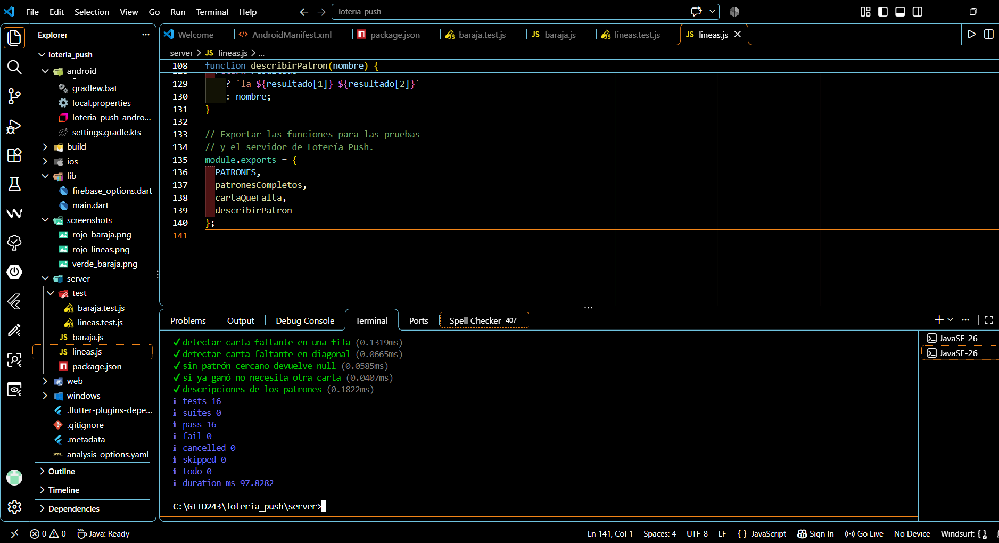

### Patrones ganadores

La aplicación reconoce 13 patrones:

- 4 filas.
- 4 columnas.
- 2 diagonales.
- 4 esquinas.
- Centro.
- Tabla llena.

### Pruebas realizadas

1. Verificar los 13 patrones ganadores.
2. Comprobar una tabla sin cartas cantadas.
3. Identificar la primera fila.
4. Identificar la primera columna.
5. Identificar la primera diagonal.
6. Identificar la segunda diagonal.
7. Identificar las cuatro esquinas.
8. Identificar el centro.
9. Rechazar patrones incompletos.
10. Ignorar cartas que no pertenecen a la tabla.
11. Reconocer la tabla llena.
12. Detectar una carta faltante en una fila.
13. Detectar una carta faltante en una diagonal.
14. Reconocer cuando no existe un patrón cercano.
15. Evitar avisos cuando ya existe un ganador.
16. Generar descripciones de los patrones.

### Resultado

Se implementaron las reglas para identificar
patrones ganadores y detectar cuándo falta
una sola carta para completar una línea.

Las funciones se verificaron mediante
16 pruebas automatizadas.

## Ronda 3. Mensajes push de Firebase

### Objetivo

Crear y comprobar los mensajes que utilizará
Lotería Push para notificar a los jugadores
cuando se cante una carta, cuando estén cerca
de ganar y cuando termine la partida.

Se utilizó la metodología TDD para desarrollar
las funciones y verificar sus resultados.

### Archivos desarrollados

- `server/test/mensajes.test.js`
- `server/mensajes.js`

### Fase ROJA

Primero se creó el archivo mensajes.test.js,
con nueve pruebas automatizadas.

Las pruebas verifican la estructura de los
mensajes, los destinatarios, los tiempos de
caducidad, los canales de notificaciones
y los límites de tamaño.

Al ejecutarlas inicialmente, fallaron porque
todavía no existía el archivo mensajes.js.

**Comando utilizado:**

`node --test test/mensajes.test.js`

**Evidencia de la fase ROJA:**

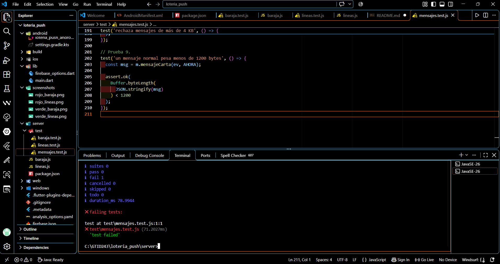

### Fase VERDE

Posteriormente se creó el archivo mensajes.js,
que permite construir los mensajes de
notificación de acuerdo con el formato
requerido por Firebase Cloud Messaging.

Se implementaron tres tipos de mensajes:

1. Carta: anuncia una carta cantada.
2. ¡Casi!: avisa cuando falta una carta para ganar.
3. ¡Lotería!: informa quién ganó la partida.

También se agregaron funciones para convertir
los datos a texto, configurar los destinatarios
y comprobar el tamaño de los mensajes.

**Evidencia de la fase VERDE:**

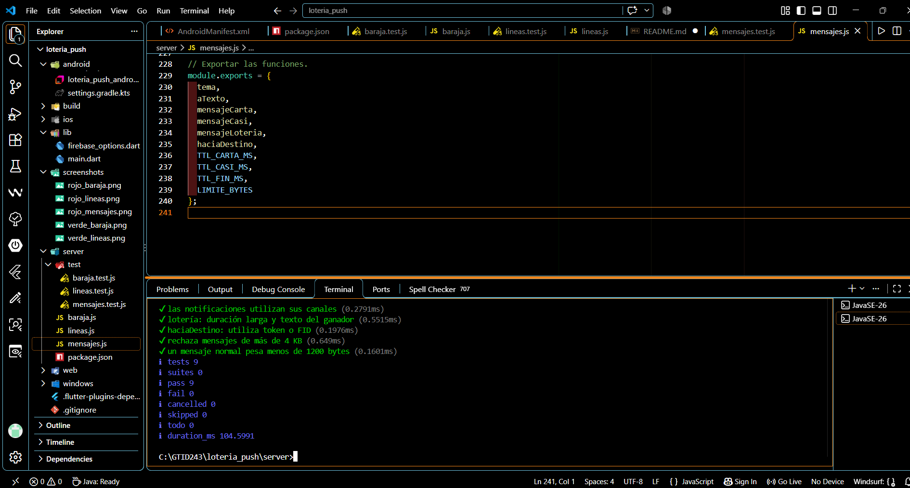

### Pruebas realizadas

1. Verificar que las cartas se envíen al tema de la sala.
2. Comprobar que todos los datos sean cadenas de texto.
3. Verificar que los mensajes de cartas caduquen en 60 segundos.
4. Comprobar las claves de colapso de notificaciones.
5. Verificar los canales cartas y momentos.
6. Comprobar la duración y el texto del mensaje de Lotería.
7. Verificar los destinatarios mediante token o FID.
8. Rechazar mensajes que superen los 4 KB.
9. Comprobar el tamaño de un mensaje normal.

## Ronda 4. Las salas, las reglas y la seguridad del juego

### Objetivo

Implementar las funciones necesarias para administrar
las salas de Lotería Push, registrar jugadores,
controlar las cartas cantadas y comprobar los
resultados de cada partida.

También se desarrollaron medidas de seguridad para
evitar accesos no autorizados y jugadas inválidas.

### Archivos desarrollados

- `server/test/sala.test.js`
- `server/sala.js`

### Fase ROJA

Primero se creó el archivo sala.test.js,
que contiene 18 pruebas automatizadas.

Estas pruebas verifican el registro de jugadores,
la validación de nombres, los límites de las salas,
las claves de acceso y las reglas para ganar.

Al ejecutar las pruebas inicialmente, aparecieron
errores porque todavía no existía sala.js.

**Comando utilizado:**

`node --test test/sala.test.js`

**Evidencia de la fase ROJA:**

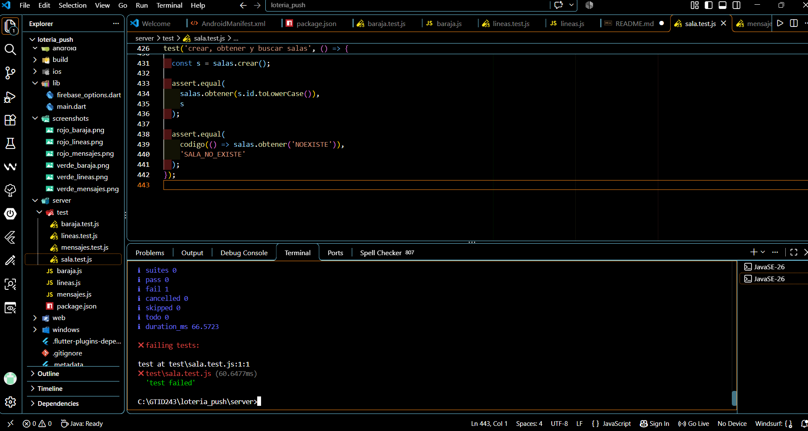

### Fase VERDE

Posteriormente se implementó el archivo sala.js,
que contiene las clases Sala y Salas.

La clase Sala controla los jugadores, las tablas,
las cartas cantadas y el ganador de una partida.

La clase Salas permite crear y localizar las
salas disponibles.

Se implementaron validaciones para impedir que
los jugadores realicen acciones no autorizadas.

**Evidencia de la fase VERDE:**

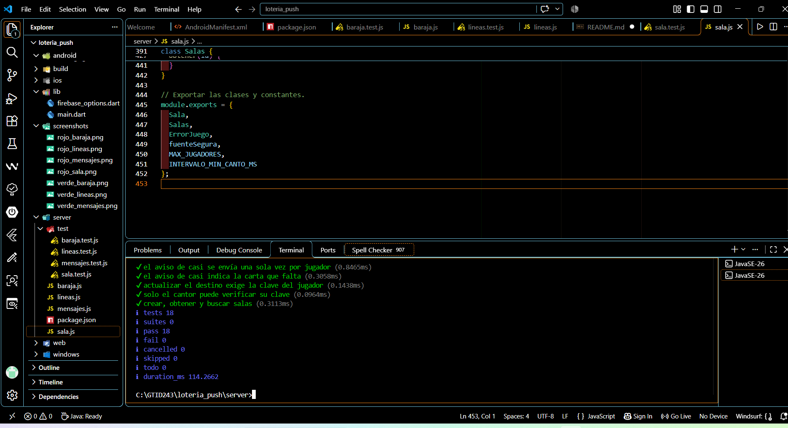

### Pruebas realizadas

1. Registrar jugadores y generar tablas de 16 cartas.
2. Permitir jugar sin activar notificaciones.
3. Rechazar nombres y destinos inválidos.
4. Aceptar nombres con acentos y eñes.
5. Limitar las salas a 30 jugadores.
6. Respetar el orden secreto de las cartas.
7. Exigir un intervalo mínimo de dos segundos.
8. Consultar el estado sin revelar el mazo.
9. Evitar modificaciones externas del estado.
10. Rechazar reclamaciones sin patrones completos.
11. Verificar las claves de los jugadores.
12. Comprobar si un jugador realmente ganó.
13. Impedir nuevas jugadas después de una victoria.
14. Enviar el aviso "¡Casi!" una sola vez.
15. Identificar la carta faltante para ganar.
16. Proteger la actualización de los destinos.
17. Verificar la clave del cantor.
18. Crear y buscar salas correctamente.

### Medidas de seguridad implementadas

- Cada jugador recibe una clave individual.
- El cantor tiene una clave exclusiva.
- El mazo permanece oculto en el servidor.
- Solo se permite un ganador por partida.
- Se establece un límite de 30 jugadores por sala.
- Deben transcurrir al menos dos segundos entre cartas.
- Se utilizan comparaciones seguras para las claves.
- Se validan los nombres y destinos de notificaciones.

## Ronda 5. El servidor HTTP y el envío seguro

### Objetivo

Implementar un servidor HTTP con Node.js para
administrar las partidas de Lotería Push y preparar
el envío seguro de notificaciones mediante Firebase.

Se aplicó la metodología TDD para comprobar
el funcionamiento de las peticiones HTTP y el
manejo de errores.

### Archivos desarrollados

- `server/enviador.js`
- `server/test/servidor.test.js`
- `server/servidor.js`

### Fase ROJA

Primero se creó servidor.test.js con 12 pruebas
automatizadas.

Estas pruebas comprueban la creación de salas,
el registro de jugadores, el canto de cartas,
las notificaciones y la seguridad de las peticiones.

Al ejecutar las pruebas inicialmente, fallaron
porque todavía no existía servidor.js.

**Comando utilizado:**

`node --test test/servidor.test.js`

**Evidencia de la fase ROJA:**

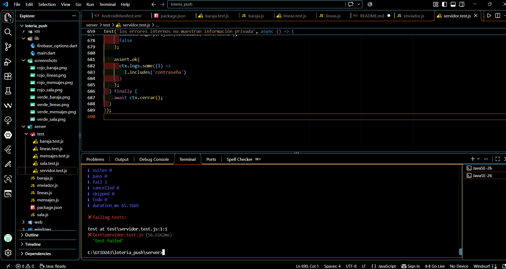

### Fase VERDE

Posteriormente se implementó servidor.js, que
permite recibir peticiones HTTP, consultar las
partidas y preparar el envío de notificaciones.

También se desarrolló enviador.js, que permite
utilizar notificaciones simuladas durante
las pruebas o Firebase Cloud Messaging
cuando se configure el envío real.

**Evidencia de la fase VERDE:**

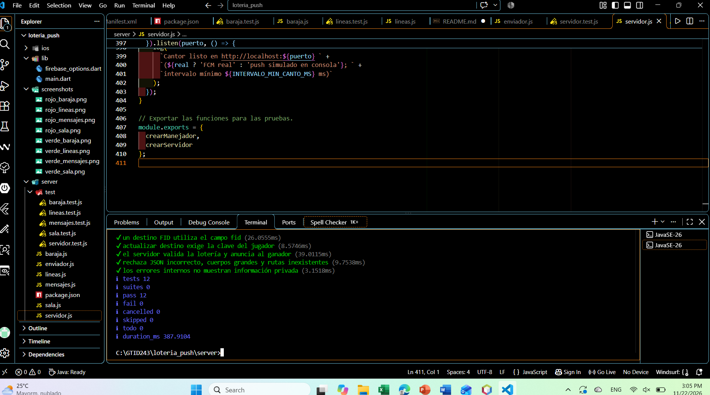

### Pruebas realizadas

1. Crear salas, registrar jugadores y cantar cartas.
2. Exigir la clave del cantor.
3. Limitar la velocidad de los cantos.
4. Consultar las cartas cantadas.
5. Mantener el estado cuando Firebase falla.
6. Enviar avisos personales y detectar tokens inválidos.
7. Conservar destinos ante errores de formato.
8. Preparar mensajes dirigidos mediante FID.
9. Proteger la actualización de los destinos.
10. Validar al ganador y notificar la victoria.
11. Rechazar peticiones incorrectas.
12. Proteger información privada ante errores internos.

### Resultado

Se implementó el servidor HTTP y se verificó
su funcionamiento mediante 12 pruebas.

Las pruebas utilizaron un enviador simulado,
por lo que no fue necesario enviar
notificaciones reales a Firebase.

### Prueba general del servidor

Se ejecutó el comando:

`npm test`

Este comando permite comprobar conjuntamente
las pruebas de la baraja, los patrones
ganadores, los mensajes push, las salas
y el servidor HTTP.

**Evidencia de la prueba general:**

## Ronda 6. La aplicación Flutter: eventos y patrones ganadores

### Objetivo

Implementar y comprobar la interpretación de los
eventos que recibe Lotería Push, así como la
identificación de los patrones ganadores de
una tabla de 4 filas por 4 columnas.

Se utilizó la metodología TDD para desarrollar
las funciones mediante las fases ROJO y VERDE.

### Archivos desarrollados

- `test/evento_lineas_test.dart`
- `lib/dominio/evento.dart`
- `lib/dominio/lineas.dart`

### Fase ROJA

Primero se creó el archivo evento_lineas_test.dart,
que contiene 17 pruebas automatizadas.

Las pruebas verifican que Flutter pueda interpretar
los datos recibidos por las notificaciones push,
validar sus valores y reconocer los patrones ganadores.

Al ejecutar las pruebas inicialmente, aparecieron
errores porque todavía no existían los archivos
evento.dart y lineas.dart.

**Comando utilizado:**

`flutter test test/evento_lineas_test.dart`

**Evidencia de la fase ROJA:**

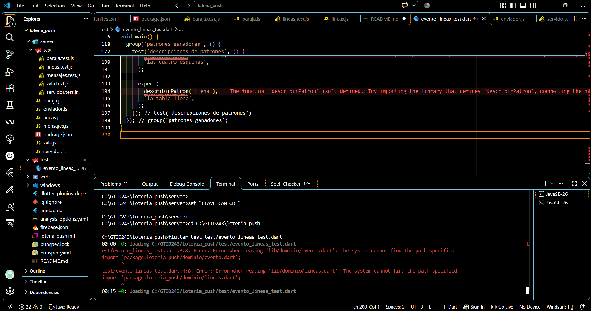

### Fase VERDE

Posteriormente se implementaron los archivos
evento.dart y lineas.dart.

En evento.dart se desarrollaron las clases
EventoJuego, CartaCantada, LoteriaCantada
y CasiGanas.

Estas clases permiten identificar los diferentes
tipos de eventos y descartar información incorrecta.

En lineas.dart se implementaron los 13 patrones
ganadores utilizados en las tablas de lotería.

**Evidencia de la fase VERDE:**

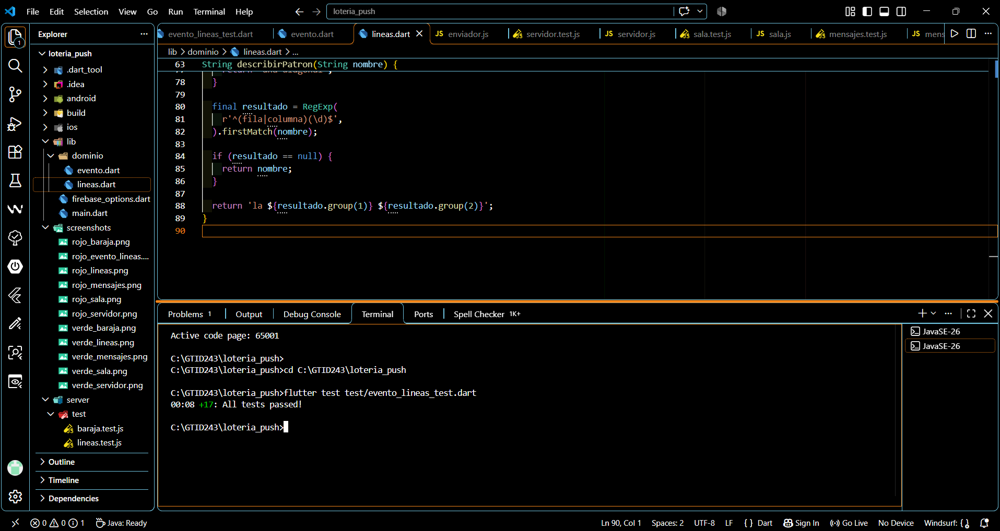

### Pruebas realizadas

#### Interpretación de eventos

1. Interpretar una carta con números en texto.
2. Aceptar valores numéricos enteros.
3. Reconocer los eventos de Lotería y ¡Casi!
4. Rechazar eventos con datos incompletos.
5. Descartar valores incorrectos o fuera de rango.
6. Normalizar los códigos de sala a mayúsculas.

### Ronda 6. Control de la partida y recuperación de cartas

#### Objetivo

Implementar la lógica que permite a Flutter
mantener el orden de las cartas cantadas,
detectar notificaciones repetidas e identificar
cuando falta una carta durante la partida.

Para desarrollar estas funciones se aplicó
la metodología TDD mediante las fases
ROJO y VERDE.

#### Archivos desarrollados

- `test/partida_test.dart`
- `lib/dominio/partida.dart`

#### Fase ROJA

Primero se creó el archivo partida_test.dart,
que contiene 10 pruebas automatizadas.

Estas pruebas verifican el orden de las cartas,
la detección de eventos duplicados, los huecos
en la secuencia y la identificación de
patrones ganadores.

Al ejecutar las pruebas inicialmente, aparecieron
errores porque todavía no existía partida.dart.

**Comando utilizado:**

`flutter test test/partida_test.dart`

**Evidencia de la fase ROJA:**

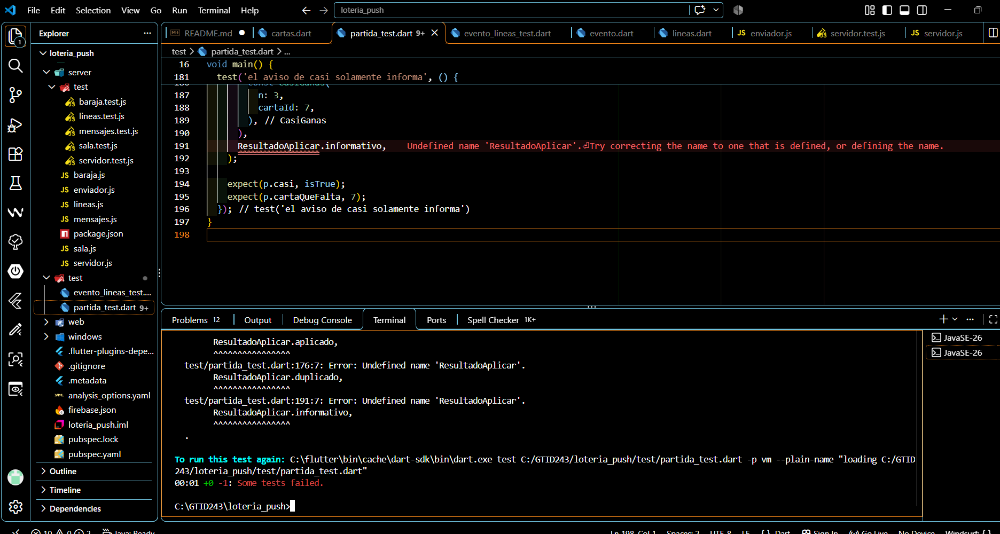

#### Fase VERDE

Posteriormente se implementó partida.dart,
que contiene la clase Partida y la enumeración
ResultadoAplicar.

Se desarrollaron funciones para procesar las
cartas recibidas, identificar duplicados,
detectar cartas faltantes y aplicar grupos
de cartas en el orden correcto.

También se implementó la validación local
de patrones ganadores para habilitar
el botón de Lotería.

**Evidencia de la fase VERDE:**

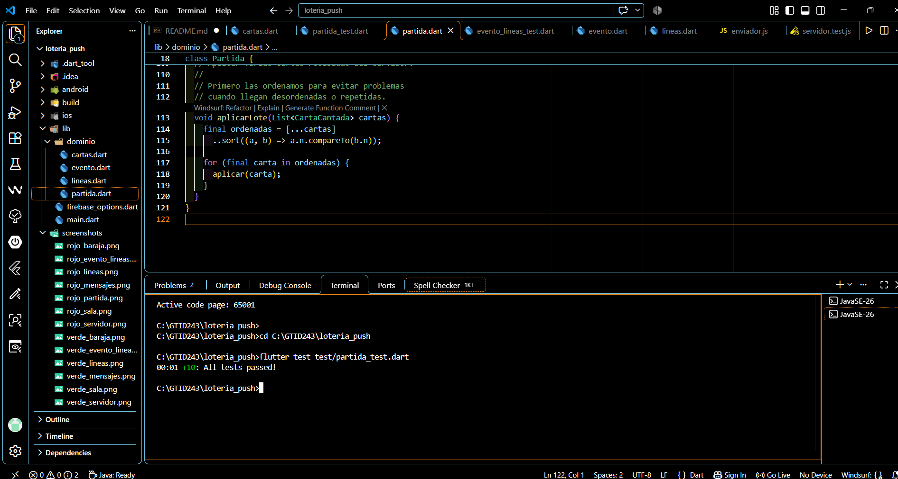

#### Pruebas realizadas

1. Aplicar cartas recibidas en orden.
2. Ignorar notificaciones repetidas.
3. Detectar huecos cuando falta una carta.
4. Procesar cartas desordenadas y duplicadas.
5. Detener el procesamiento ante un hueco.
6. Marcar únicamente las cartas cantadas.
7. Habilitar Lotería al completar un patrón.
8. Impedir reclamar cuando ya existe un ganador.
9. Ignorar avisos de victoria repetidos.
10. Procesar el aviso de "¡Casi!" como informativo.

## Ronda 7. Interfaces, pruebas y controlador

### Objetivo

Desarrollar las interfaces y el controlador que
permiten coordinar la aplicación Flutter con
el servidor Node.js y las notificaciones push.

Se utilizó la metodología TDD para comprobar
el registro de jugadores, la recepción de
notificaciones, la sincronización de cartas
y la recuperación de partidas.

### Archivos desarrollados

- `lib/dominio/api_juego.dart`
- `lib/dominio/puerto_push.dart`
- `lib/dominio/almacen.dart`
- `lib/dominio/sesion.dart`
- `lib/dominio/controlador.dart`
- `test/falsos.dart`
- `test/controlador_test.dart`

### Fase ROJA

Primero se creó el archivo controlador_test.dart,
que contiene 22 pruebas automatizadas.

Para realizar las pruebas se utilizaron clases
falsas que simulan el servidor y Firebase
sin necesidad de conectarse a servicios reales.

Al ejecutar las pruebas inicialmente, aparecieron
errores porque todavía no existía controlador.dart.

**Comando utilizado:**

`flutter test test/controlador_test.dart`

**Evidencia de la fase ROJA:**

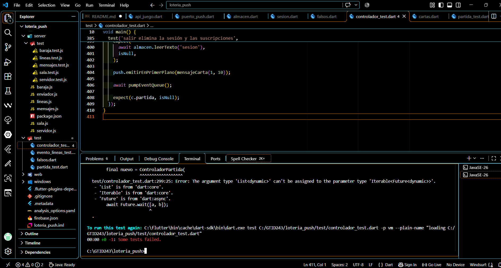

### Fase VERDE

Posteriormente se implementó controlador.dart,
que contiene la clase ControladorPartida.

Esta clase permite coordinar las operaciones
de la partida, los mensajes recibidos y la
información proporcionada por el servidor.

También se implementaron funciones para
guardar sesiones, recuperar partidas y
actualizar los destinos de notificaciones.

**Evidencia de la fase VERDE:**

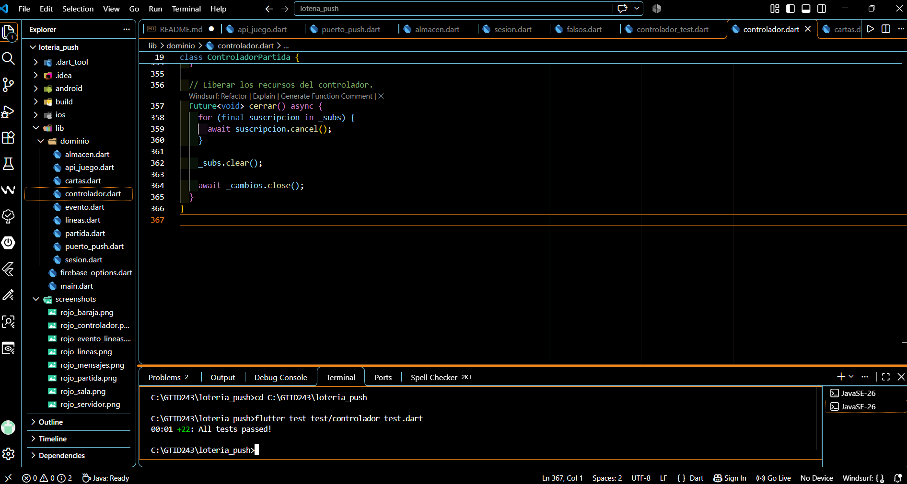

### Pruebas realizadas

## Ronda 9. Pantallas, ViewModels y arranque de la aplicación

### Objetivo

Desarrollar la interfaz gráfica de Lotería Push
mediante Flutter, permitiendo que los usuarios
puedan crear salas, unirse a partidas, visualizar
sus tablas y consultar las cartas cantadas.

También se integraron los componentes de
Firebase, el servidor Node.js y el almacenamiento
local para iniciar la aplicación.

### Archivos desarrollados

- `lib/presentacion/vms.dart`
- `lib/presentacion/pantalla_inicio.dart`
- `lib/presentacion/pantalla_cantor.dart`
- `lib/presentacion/pantalla_juego.dart`
- `lib/app.dart`
- `lib/main.dart`
- `test/pantalla_test.dart`

### Pantalla de inicio

Se desarrolló una pantalla donde los jugadores
pueden ingresar su nombre y el código de una sala.

También se incorporó un botón para crear una
sala como cantor y una explicación sobre los
permisos de notificaciones.

**Evidencia:**

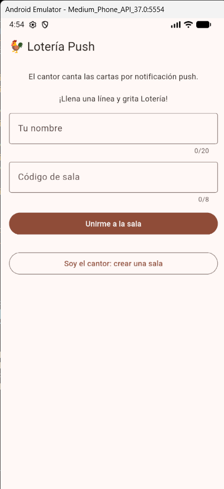

### Pantalla del cantor

Se implementó una interfaz que permite crear
salas y obtener un código para compartirlo
con los jugadores.

El cantor puede sacar cartas manualmente o
activar el canto automático cada seis segundos.

Durante las pruebas se creó la sala AJXFV
y se cantó correctamente la primera carta,
El Corazón.

**Evidencia:**

!

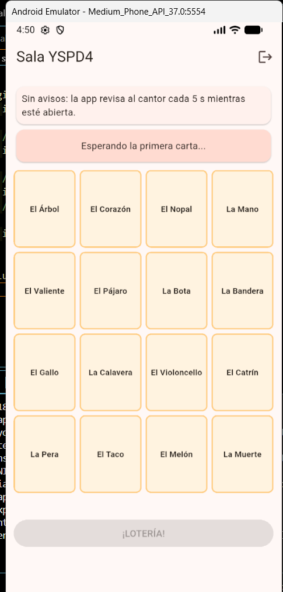

### Pruebas automatizadas

Se creó el archivo `test/pantalla_test.dart`
con tres pruebas de interfaz.

Las pruebas verifican:

1. Que aparezcan el código de sala, las cartas
   y el mensaje de espera.
2. Que el botón ¡LOTERÍA! se habilite al
   completar un patrón ganador.
3. Que se muestre al ganador y se deshabilite
   el botón cuando termina la partida.

